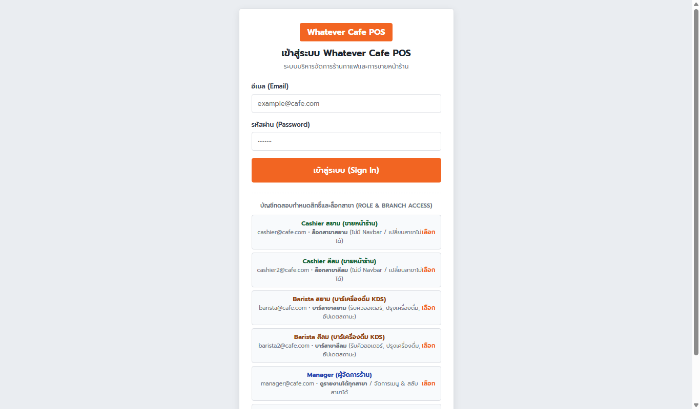
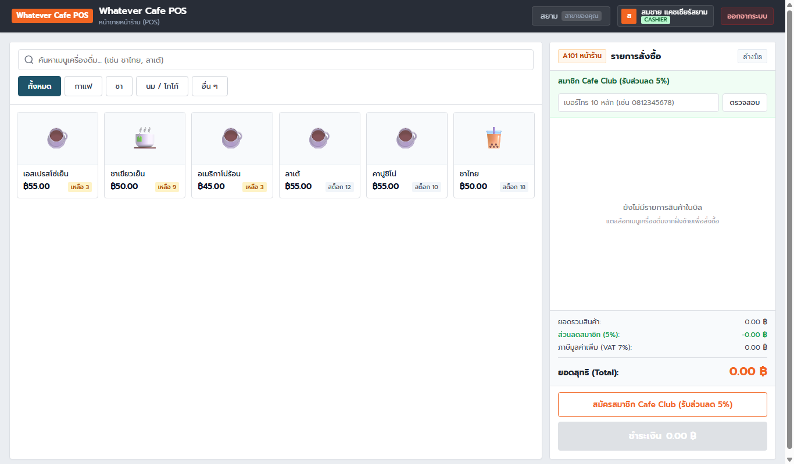
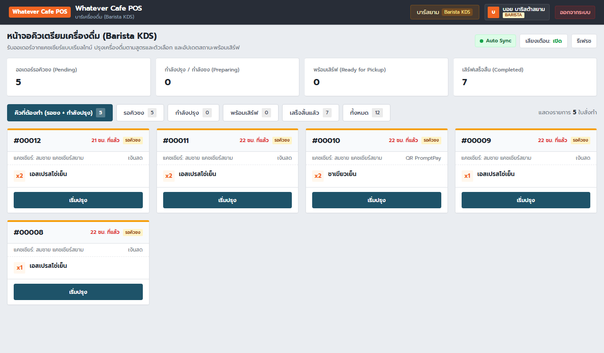
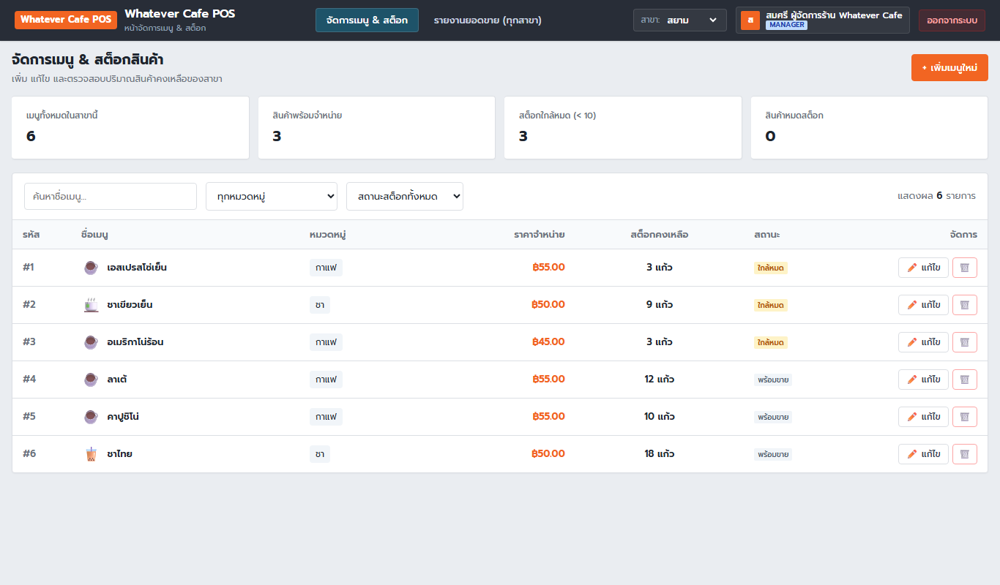
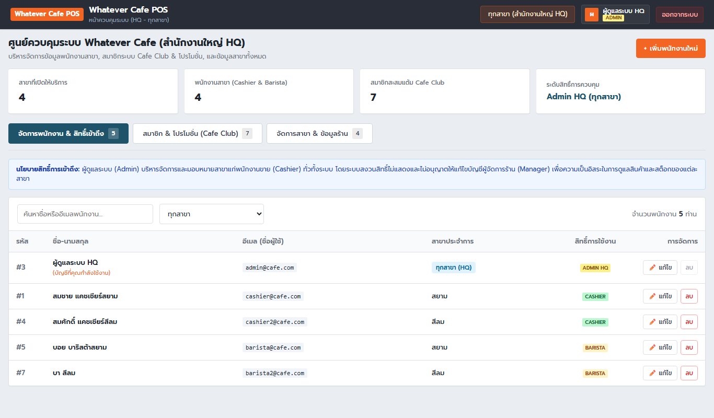
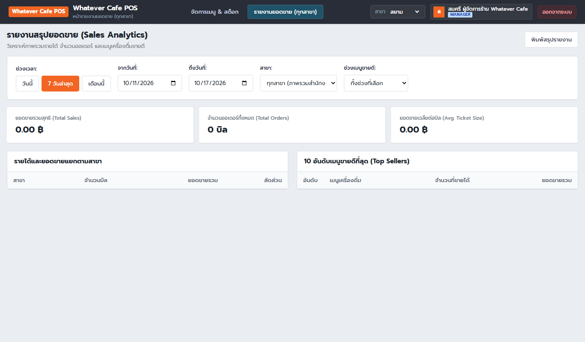

# ☕ Whatever Cafe POS & Smart Inventory System

ระบบบริหารจัดการร้านกาแฟ Whatever Cafe POS พร้อมระบบคิดเงินหน้าร้าน ตัดสต็อกสินค้า และรายงานสรุปยอดขาย

---

## 📸 ภาพตัวอย่างหน้าจอระบบ (User Interface Preview)

### 1. หน้าเข้าสู่ระบบ (Login & Quick Role Switcher)
> รองรับการเข้าสู่ระบบด้วย Email/Password พร้อมปุ่มเลือกสลับบัญชีทดสอบตามบทบาท (Admin HQ, Manager, Cashier, Barista) ได้ในคลิกเดียว



---

### 2. หน้าจอขายหน้าร้าน POS (Cashier POS)
> หน้าจอสัมผัสสไตล์ Whatever Cafe POS: ค้นหาเมนู, ปรับแต่งขนาดแก้ว/ความหวาน/ท็อปปิ้ง, ค้นหาสมาชิก Cafe Club รับส่วนลด 5%, คำนวณ VAT 7%, รับชำระเงินสดพร้อมคำนวณเงินทอน หรือสแกน QR PromptPay และออกใบเสร็จแบบ Thermal Slip



---

### 3. หน้าจอเตรียมเครื่องดื่มในบาร์ (Barista KDS - Kitchen Display System)
> รับออเดอร์เรียลไทม์จากแคชเชียร์ (< 2 วินาที) แสดงรายละเอียดตัวเลือกการชง (ขนาด, ความหวาน, ท็อปปิ้ง) พร้อมระบบจับเวลา, เสียงแจ้งเตือน (Chime Alert) และอัปเดตสถานะคิว (รอคิวชง ➔ กำลังปรุง ➔ พร้อมเสิร์ฟ ➔ เสร็จสิ้น)



---

### 4. หน้าจัดการเมนูและสต็อกสินค้า (Manager Menu & Stock Management)
> สำหรับผู้จัดการร้าน: สรุปตัวชี้วัด (KPIs) เมนูทั้งหมด, พร้อมจำหน่าย, สต็อกใกล้หมด (< 10), สินค้าหมดสต็อก ตลอดจนเพิ่ม แก้ไข ลบเมนู และอัปเดตจำนวนสต็อกคงเหลือ



---

### 5. ศูนย์ควบคุมระบบส่วนกลางสำนักงานใหญ่ (Admin HQ Central Management)
> ศูนย์ควบคุมระบบภาพรวมทุกสาขาโดย Super Admin: จัดการพนักงานและสิทธิ์การเข้าถึง (Cashier & Barista ยกเว้น Manager), ระบบสมาชิก Cafe Club & โปรโมชั่น, และข้อมูลเครือข่ายสาขา



---

### 6. หน้ารายงานสรุปยอดขายและสถิติ (Manager Sales Analytics)
> วิเคราะห์รายได้รวม, จำนวนบิล, ยอดเฉลี่ยต่อบิล, สัดส่วนรายได้แยกตามสาขา และ 10 อันดับเมนูขายดีที่สุด กรองดูตามช่วงวัน (วันนี้, 7 วัน, เดือนนี้) หรือระบุช่วงวันที่และสาขาที่ต้องการได้อย่างอิสระ



---

## 🛠️ สิ่งที่ต้องมีในเครื่อง (Prerequisites)

* **Node.js** (เวอร์ชัน 18 ขึ้นไป)
* **MySQL Server** (หรือ **Docker Desktop** สำหรับรัน MySQL + phpMyAdmin ผ่าน Docker Compose)

---

## 🚀 ขั้นตอนการติดตั้งและรันโปรเจกต์

### 1. ติดตั้ง Dependencies
เปิด Terminal ในโฟลเดอร์โปรเจกต์แล้วรัน:
```bash
npm install
```

### 2. ตั้งค่าไฟล์สภาพแวดล้อม (`.env`)
คัดลอกไฟล์ `.env.example` เป็น `.env`:
```bash
cp .env.example .env
```
ตรวจสอบและแก้ไขรหัสผ่าน MySQL ในไฟล์ `.env` ให้ตรงกับเครื่องของคุณ:
```env
DB_HOST=localhost
DB_PORT=3306
DB_USER=root
DB_PASSWORD=รหัสผ่าน_MYSQL_ของคุณ
DB_NAME=cafe_pos
PORT=3000
```

### 3. เปิดบริการ MySQL (เลือกวิธีใดวิธีหนึ่ง)

* **วิธีที่ A: ใช้ Docker Compose (สะดวกที่สุด)**
  ```bash
  docker compose up -d
  ```
  *(จะเปิด MySQL บนพอร์ต 3306 และ phpMyAdmin บนพอร์ต 8080: [http://localhost:8080](http://localhost:8080))*

* **วิธีที่ B: ใช้ MySQL ในเครื่อง (XAMPP / MySQL Service)**
  เปิด MySQL Server ตามปกติ

### 4. เตรียมฐานข้อมูลและข้อมูลเริ่มต้น (Database Setup)
รันคำสั่งเพียงคำสั่งเดียวเพื่อสร้างตารางทั้งหมดจาก `schema.sql` และใส่ข้อมูลตัวอย่าง:
```bash
npm run db:setup
```

### 5. สั่งรันแอปพลิเคชัน
```bash
npm run dev
```
เซิร์ฟเวอร์จะเริ่มทำงานที่: **[http://localhost:3000](http://localhost:3000)**

---

## 💻 การใช้งานผ่านหน้าเว็บ (Whatever Cafe POS Web UI)

เข้าใช้งานผ่านเบราว์เซอร์: **[http://localhost:3000](http://localhost:3000)** (ระบบจะนำทางไปยังหน้า Login โดยอัตโนมัติ)

ระบบถูกออกแบบเป็น **Multi-Page Architecture สำหรับ Whatever Cafe POS** โดยแยกแต่ละหน้าออกจากกันอย่างชัดเจน พร้อมระบบความปลอดภัยและการแบ่งสิทธิ์จากตารางผู้ใช้ทั่วไป (`user`):

### 🔑 บัญชีเข้าใช้งานระบบกำหนดสิทธิ์และบทบาท (Multi-Branch POS Architecture)
| บทบาท (Role) | อีเมล (Email) | รหัสผ่าน (Password) | สิทธิ์และการควบคุมในระบบ | หน้าหลัก |
| :--- | :--- | :--- | :--- | :--- |
| **Cashier** (พนักงานขายหน้าร้าน) | `cashier@cafe.com` | `password123` | **ขายหน้าร้าน (POS)** ประจำสาขา บันทึกออเดอร์ ค้นหาสมาชิก ออกใบเสร็จ | `/order.html` |
| **Barista** (บาริสต้าเตรียมเครื่องดื่ม) | `barista@cafe.com` | `password123` | **บาร์เครื่องดื่ม (Barista KDS)** รับคิวออเดอร์เรียลไทม์ ปรุงเครื่องดื่ม และอัปเดตสถานะ (รอชง ➔ กำลังปรุง ➔ พร้อมเสิร์ฟ ➔ เสร็จสิ้น) | `/barista.html` |
| **Manager** (ผู้จัดการร้าน) | `manager@cafe.com` | `password123` | **จัดการเมนู & สต็อกสินค้า** ทุกสาขาอย่างอิสระ ตรวจสอบรายงานยอดขาย | `/menu.html` |
| **Admin** (ผู้ดูแลระบบสูงสุด HQ) | `admin@cafe.com` | `password123` | **คุมระบบส่วนกลางคนเดียว (HQ):** จัดการพนักงานสาขา (Cashier & Barista ยกเว้น Manager), ระบบสมาชิก Cafe Club & โปรโมชั่น, จัดการสาขา *(ไม่มีสิทธิ์เข้าถึงรายงานยอดขาย)* | `/admin.html` |

> ☕ **บทบาท Barista (Kitchen Display System - KDS):**
> ตรงตามข้อกำหนด `wk03-requirements` (FR-03, FR-04, FR-08, NFR-01) และ `wk04-user-stories` (US-03, US-04):
> 1. รับข้อมูลออเดอร์พร้อมตัวเลือกเครื่องดื่ม (ขนาดแก้ว, ความหวาน, ท็อปปิ้ง) ส่งตรงจากหน้าจอแคชเชียร์ทันทีหลังชำระเงินสำเร็จ (< 2 วินาที)
> 2. แสดงสถานะคิว 4 ระดับ: `รอคิวชง (pending)` ➔ `กำลังปรุง (preparing)` ➔ `พร้อมเสิร์ฟ (ready)` ➔ `เสร็จสิ้น (completed)`
> 3. ระบบแจ้งเตือนเสียง (Chime Alert) และตัวจับเวลาแบบเรียลไทม์ พร้อมตัวกรองคิวตามสถานะ

---

### 📄 โครงสร้างหน้าเว็บแยกตามฟังก์ชัน (Multi-Page)
1. **หน้าเข้าสู่ระบบ (`/login.html`):**
   * ล็อกอินด้วย Email & Password พร้อมปุ่มเลือกบัญชีทดสอบในคลิกเดียว (Admin HQ, Manager, Cashier, Barista)
2. **หน้าขายหน้าร้าน POS (`/order.html`):** *(Cashier)*
   * หน้าจอสัมผัสสไตล์ Whatever Cafe POS: แสดงการ์ดเมนูเครื่องดื่มพร้อมป้ายสต็อกแบบเรียลไทม์
   * หน้าต่างปรับแต่งเครื่องดื่ม (ขนาดแก้ว S/M/L, ระดับความหวาน 0-100%, ท็อปปิ้งไข่มุก/ครีมชีส)
   * บิลฝั่งขวา: ค้นหาสมาชิก Cafe Club (ลด 5%), คำนวณ VAT 7% และยอดสุทธิ
   * ชำระเงินสด (พร้อมเครื่องคิดเงินทอน) หรือสแกน QR PromptPay และออกใบเสร็จแบบ Thermal Slip
3. **หน้าจอคิวบาริสต้า KDS (`/barista.html`):** *(Barista)*
   * หน้าจอเตรียมเครื่องดื่มในบาร์ รับออเดอร์แบบเรียลไทม์ (Auto-Sync)
   * แสดงรายละเอียดตัวเลือกการชง (ขนาด, ความหวาน, ท็อปปิ้ง)
   * อัปเดตสถานะการปรุงและส่งมอบเครื่องดื่ม
4. **หน้าจัดการเมนูและสต็อก (`/menu.html`):** *(Manager)*
   * สรุปตัวชี้วัด (KPIs): เมนูทั้งหมด, พร้อมจำหน่าย, สต็อกใกล้หมด (<10), สินค้าหมด
   * เพิ่ม/แก้ไข/ลบเมนูเครื่องดื่ม และปรับปรุงจำนวนสต็อกคงเหลือ
5. **หน้าจัดการระบบศูนย์กลาง (`/admin.html`):** *(Admin HQ)*
   * ศูนย์ควบคุม 3 ฟังก์ชัน: พนักงานและสิทธิ์ (Cashier & Barista ยกเว้น Manager), สมาชิก Cafe Club & โปรโมชั่น, และเครือข่ายสาขา
   * สรุปตัวชี้วัด (KPIs): สาขาทั้งหมด, พนักงานปฏิบัติการ, สมาชิก Cafe Club
6. **หน้ารายงานยอดขาย (`/report.html`):** *(เฉพาะ Manager เท่านั้น)*
   * กรองดูยอดขายตามช่วงวัน (วันนี้, 7 วัน, เดือนนี้) หรือเลือกเฉพาะสาขา / ภาพรวมทุกสาขา
   * สรุปยอดขายรวม, จำนวนบิล, ยอดเฉลี่ยต่อบิล, รายได้แยกตามสาขา, และ 10 อันดับเมนูขายดีที่สุด

---

## 📡 สรุป REST API Endpoints

### 1. หมวดเมนู (Menu)
| Method | Endpoint | คำอธิบาย |
| :--- | :--- | :--- |
| `GET` | `/api/menu?branchId=1` | ดึงรายการเมนูทั้งหมดของสาขา |
| `GET` | `/api/menu/:id?branchId=1` | ดึงข้อมูลเมนูตาม ID |
| `POST` | `/api/menu` | เพิ่มเมนูใหม่ (`branchId`, `categoryId`, `name`, `price`, `stockQuantity`) |
| `PUT` | `/api/menu/:id` | แก้ไขข้อมูลเมนู (`branchId`, `categoryId`, `name`, `price`, `stockQuantity`) |
| `DELETE` | `/api/menu/:id?branchId=1` | ลบเมนูออกจากสาขา |

### 2. หมวดออเดอร์และการจัดการคิวบาริสต้า (Orders & Barista KDS)
| Method | Endpoint | คำอธิบาย |
| :--- | :--- | :--- |
| `POST` | `/api/orders` | บันทึกการสั่งซื้อหน้าร้าน ตัดสต็อกสินค้า และคำนวณส่วนลดสมาชิก |
| `GET` | `/api/orders/pending?branchId=1` | ดึงรายการคิวเครื่องดื่มที่รอดำเนินการ (สำหรับ Barista KDS) |
| `PATCH` | `/api/orders/:id/status` | อัปเดตสถานะคิว (`pending` ➔ `preparing` ➔ `ready` ➔ `completed`) |

### 3. หมวดสมาชิก Cafe Club (Members)
| Method | Endpoint | คำอธิบาย |
| :--- | :--- | :--- |
| `GET` | `/api/members/search?phone=0812345678` | ค้นหาสมาชิกด้วยเบอร์โทรศัพท์เพื่อรับส่วนลด 5% |
| `POST` | `/api/members` | สมัครสมาชิกใหม่หน้าร้าน |

### 4. หมวดรายงานยอดขาย (Reports - เฉพาะ Manager)
| Method | Endpoint | คำอธิบาย |
| :--- | :--- | :--- |
| `GET` | `/api/reports/sales?from=2026-10-01&to=2026-10-05&branchId=1&top=all` | ดึงรายงานสรุปยอดขายตามช่วงวันที่และสาขา |

### 5. หมวดผู้ดูแลระบบส่วนกลาง (Admin HQ)
| Method | Endpoint | คำอธิบาย |
| :--- | :--- | :--- |
| `GET` | `/api/admin/staff` | ดึงรายชื่อพนักงานทุกสาขา (ยกเว้น Manager) |
| `POST` | `/api/admin/staff` | เพิ่มพนักงานใหม่ (Cashier หรือ Barista) |
| `PUT` | `/api/admin/staff/:id` | แก้ไขข้อมูลพนักงาน |
| `DELETE` | `/api/admin/staff/:id` | ลบบัญชีพนักงานออกจากระบบ |
| `GET` | `/api/admin/members` | ดูและค้นหารายชื่อสมาชิกทั้งหมด |
| `POST` | `/api/admin/members` | เพิ่มสมาชิก Cafe Club |
| `PUT` | `/api/admin/members/:id` | แก้ไขข้อมูลสมาชิกและแต้มสะสม |
| `DELETE` | `/api/admin/members/:id` | ลบสมาชิก |
| `GET` | `/api/admin/branches` | ดึงรายชื่อสาขาและสถิติยอดสั่งซื้อ |
| `POST` | `/api/admin/branches` | เพิ่มสาขาใหม่ |
| `PUT` | `/api/admin/branches/:id` | แก้ไขข้อมูลสาขา |
| `DELETE` | `/api/admin/branches/:id` | ลบสาขา (ป้องกันหากมีข้อมูลผูกอยู่) |

### 6. หมวดความปลอดภัยและการยืนยันตัวตน (Authentication)
| Method | Endpoint | คำอธิบาย |
| :--- | :--- | :--- |
| `POST` | `/api/auth/login` | เข้าสู่ระบบด้วย Email & Password รับ Token |
| `GET` | `/api/auth/me` | ตรวจสอบสถานะและข้อมูลผู้ใช้ปัจจุบัน |

---

## 🗄️ โครงสร้างฐานข้อมูล (Database Schema)
อ้างอิงจาก [`schema.sql`](schema.sql) ซึ่งบังคับชุดอักขระ `utf8mb4` รองรับภาษาไทย 100%:
* `branch`: สาขาของร้าน (สยาม, สีลม ฯลฯ)
* `category`: หมวดหมู่เมนู (ชา, กาแฟ, นม/โกโก้, อื่น ๆ)
* `user`: ข้อมูลบัญชีผู้ใช้ในระบบ กำหนดบทบาทการเข้าถึง (Admin, Manager, Cashier, Barista)
* `menu_item`: รายการสินค้า ราคา และจำนวนสต็อกคงเหลือ
* `member`: ข้อมูลสมาชิก Cafe Club แต้มสะสม และอัตราส่วนลด
* `orders`: ข้อมูลหัวบิลออเดอร์ วันที่เวลา วิธีชำระเงิน ผู้รับออเดอร์ และสถานะคิว (pending, preparing, ready, completed)
* `order_item`: รายการสินค้าในแต่ละออเดอร์ จำนวน ราคา และตัวเลือกการชง (notes)
* `stock_movement`: ประวัติการเปลี่ยนแปลงสต็อกสินค้า