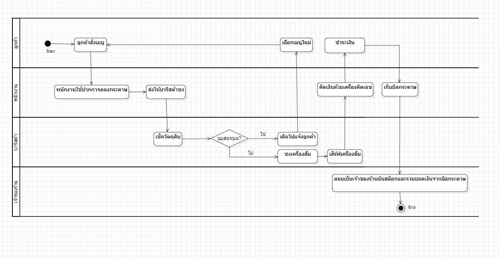
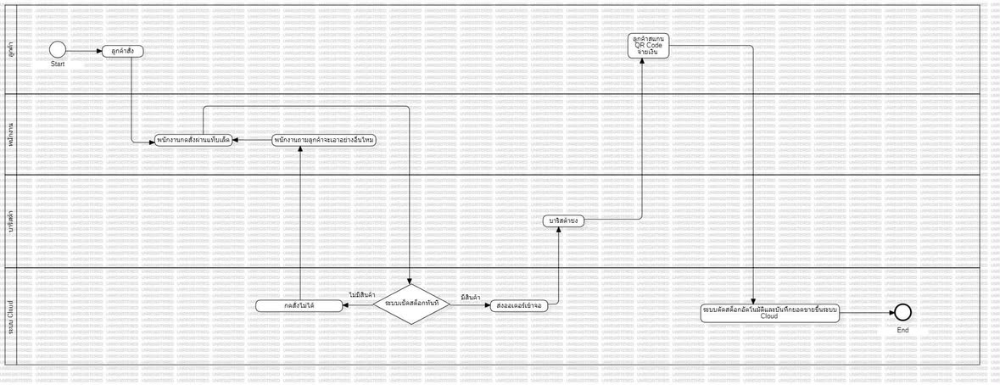

# รายงานความเป็นไปได้ของโครงการ (Project Feasibility Study)

## 📌 ภาพรวมโครงการ (Project Overview)

- **ชื่อระบบ:** ระบบ POS And Smart Inventory System
- **วัตถุประสงค์:**
  - เพื่อลดเวลาในการคิดเงินและอำนวยความสะดวกในการชำระเงินหน้าร้าน
  - เพื่อลดข้อผิดพลาดในการคำนวณยอดขายและการจดออเดอร์ด้วยมือ
  - เพื่อช่วยในการตัดสต็อกวัตถุดิบโดยอัตโนมัติแบบเรียลไทม์ และแจ้งเตือนเมื่อวัตถุดิบใกล้หมด
- **ขอบเขต (Scope):**
  - ระบบบริหารจัดการการขายหน้าร้าน (POS)
  - ระบบบันทึกคำสั่งซื้อเครื่องดื่ม/เบเกอรี่ พร้อมตัวเลือกรายละเอียดเมนู
  - ระบบจัดการคลังสินค้าหลังบ้าน (Inventory) ที่ตัดสต็อกวัตถุดิบอัตโนมัติทันทีที่มีการขายหน้าร้าน
- **ผู้มีส่วนได้ส่วนเสีย (Stakeholders):**
  - **พนักงานหน้าร้าน / บาริสต้า:** ผู้ใช้งานหลักในการกดรับออเดอร์ ดูรายการเครื่องดื่มที่ต้องชง และจัดการคิดเงินหน้าร้าน
  - **เจ้าของร้านกาแฟ:** ผู้บริหารระบบที่มีสิทธิ์ดูยอดขายรวม ตรวจสอบสต็อกวัตถุดิบของร้าน
  - **ลูกค้าของร้านกาแฟ:** ผู้ได้รับผลประโยชน์จากการบริการที่รวดเร็วขึ้น ความถูกต้องของออเดอร์ และความสะดวกในการชำระเงิน

---

## 💻 ความเป็นไปได้ด้านเทคนิค (Technical Feasibility)

### เทคโนโลยีที่ใช้ (Tech Stack)

- **Backend:** Node.js และ Express ในการพัฒนาโครงสร้างระบบ
- **Database:** MySQL
- **Platform:** Laptop and Desktop Software

### ความพร้อมของทีม (Team Readiness)

- สมาชิกในทีมมีความรู้และความเข้าใจพื้นฐานเกี่ยวกับ Node.js, Express และ MySQL ในระดับปานกลาง ซึ่งเพียงพอต่อการพัฒนาระบบตามขอบเขตที่กำหนด

### ความเสี่ยงด้านเทคนิค (Technical Risks)

- ทีมพัฒนายังขาดความเชี่ยวชาญในการเชื่อมต่อ API กับระบบภายนอก เช่น ระบบเครื่องรูดบัตร หรือระบบ QR Payment Gateway ของผู้ให้บริการจริง

### แนวทางการขจัดความเสี่ยง

- กำหนดเวลาในการศึกษาเอกสาร API ของผู้ให้บริการชำระเงินล่วงหน้า เพื่อศึกษาโครงสร้างข้อมูลก่อนเริ่มลงมือเขียนโค้ดในส่วนเชื่อมต่อการชำระเงิน

---

## 💰 ความเป็นไปได้ด้านเศรษฐศาสตร์ (Economic Feasibility)

- **ต้นทุนโดยประมาณ (Estimated Costs):**
  - คาดการณ์ประมาณ **30,000 บาท**
  - บวกค่าใช้จ่ายที่ต้องจ่ายอย่างต่อเนื่องเพื่อรักษาระบบให้ทำงานได้ เช่น ค่าเช่าเซิร์ฟเวอร์ (Server hosting) สำหรับจัดเก็บข้อมูลระบบ และค่าบำรุงรักษาระบบซอฟต์แวร์ในระยะยาว
- **ผลประโยชน์ที่ได้รับ (Benefits):**
  - ลดเวลาในการคิดเงินและอำนวยความสะดวกในการชำระเงินหน้าร้าน
  - ลดข้อผิดพลาดในการคำนวณยอดขายและการจดออเดอร์ด้วยมือ
  - ช่วยในการตัดสต็อกวัตถุดิบโดยอัตโนมัติแบบเรียลไทม์ และแจ้งเตือนเมื่อวัตถุดิบใกล้หมด
- **ระยะเวลาคืนทุน (Payback Period):**
  - เมื่อเปรียบเทียบต้นทุนทั้งหมดกับผลประโยชน์ที่ได้รับจากการประหยัดเวลาและลดข้อผิดพลาด คาดว่าโครงการนี้จะสามารถคุ้มทุนได้ภายในระยะเวลาประมาณ **6 เดือน**

---

## ⚖️ ความเป็นไปได้ด้านกฎหมาย (Legal Feasibility)

- **ข้อมูลส่วนบุคคลที่ระบบเก็บ:**
  - ข้อมูลสมาชิก Cafe Club ได้แก่ ชื่อ เบอร์โทรศัพท์ และแต้มสะสม
  - ข้อมูลพนักงานและผู้ดูแลระบบ ได้แก่ ชื่อ อีเมล รหัสผ่าน บทบาท และสาขา
  - ระบบไม่เก็บข้อมูลบัตรหรือบัญชีธนาคารของลูกค้า เพราะการชำระเงินแบบ QR เป็นการจำลอง
- **กฎหมายและระเบียบที่เกี่ยวข้อง:**
  - **พ.ร.บ.คุ้มครองข้อมูลส่วนบุคคล พ.ศ. 2562 (PDPA):** ร้านเป็นผู้ควบคุมข้อมูลส่วนบุคคลของสมาชิกและพนักงาน ข้อกำหนดที่เกี่ยวข้องกับระบบนี้
    - **มาตรา 19:** ต้องได้รับความยินยอมจากเจ้าของข้อมูล (สมาชิก) ก่อนหรือขณะเก็บรวบรวม ใช้ หรือเปิดเผยข้อมูล เว้นแต่เข้าข้อยกเว้น
    - **มาตรา 22:** เก็บข้อมูลเท่าที่จำเป็นตามวัตถุประสงค์ที่ได้แจ้งไว้
    - **มาตรา 23:** ต้องแจ้งเจ้าของข้อมูลก่อนหรือขณะเก็บ เช่น วัตถุประสงค์และระยะเวลาที่เก็บข้อมูล
    - **มาตรา 33 และ 37(3):** เจ้าของข้อมูลขอให้ลบหรือทำลายข้อมูลได้ และผู้ควบคุมข้อมูลต้องมีขั้นตอนลบหรือทำลายข้อมูลเมื่อครบกำหนดเก็บหรือเมื่อถูกร้องขอ
    - **มาตรา 37(1):** ต้องมีมาตรการรักษาความปลอดภัยที่เหมาะสม เพื่อป้องกันการสูญหาย เข้าถึง ใช้ แก้ไข หรือเปิดเผยข้อมูลโดยไม่ได้รับอนุญาต
  - **ภาษีมูลค่าเพิ่ม (VAT):** ระบบคิด VAT 7% และออกใบเสร็จรับเงิน ร้านค้าปลีกที่จดทะเบียนภาษีมูลค่าเพิ่มออกใบกำกับภาษีอย่างย่อได้ตามมาตรา 86/6 แห่งประมวลรัษฎากร (รายการที่ต้องมีในใบกำกับภาษีอยู่ในมาตรา 86/4) ต้องตรวจสอบกับผู้เชี่ยวชาญหรือกรมสรรพากรว่ารูปแบบใบเสร็จของระบบตรงตามข้อกำหนดหรือไม่
  - **ลิขสิทธิ์และสัญญาอนุญาตของซอฟต์แวร์:** ระบบใช้ Node.js, Express และ MySQL ซึ่งเป็นซอฟต์แวร์ที่เปิดให้ใช้งานได้ตามสัญญาอนุญาตของแต่ละตัว ต้องตรวจเงื่อนไขก่อนนำไปใช้เชิงพาณิชย์
- **ผลกระทบต่อการออกแบบระบบ:**
  - เก็บข้อมูลสมาชิกเท่าที่จำเป็น คือ ชื่อ เบอร์โทร และแต้ม
  - กำหนดสิทธิ์การเข้าถึงตามบทบาท (RBAC) เพื่อจำกัดว่าใครดูข้อมูลสมาชิกและพนักงานได้ โดยเฉพาะหน้า Admin
  - เก็บรหัสผ่านแบบ hash ไม่เก็บเป็นข้อความธรรมดา
  - ต้องมีฟังก์ชันแก้ไขและลบข้อมูลสมาชิกตามคำขอของเจ้าของข้อมูล ระบบมีการแก้ไขข้อมูลสมาชิกในหน้า Admin (FR-10) และมี API สำหรับลบสมาชิก (`DELETE /api/admin/members/:id`)
  - ต้องเพิ่มข้อความแจ้งและการขอความยินยอมตอนสมัครสมาชิก และกำหนดระยะเวลาเก็บข้อมูล ซึ่งยังไม่ได้ทำในต้นแบบนี้
- **ข้อสรุป:** ด้านกฎหมายไม่เป็นอุปสรรคต่อการพัฒนา โดยมีเงื่อนไขว่าต้องดำเนินการตาม PDPA ก่อนใช้งานจริงกับข้อมูลลูกค้า เอกสารนี้เป็นการวิเคราะห์เบื้องต้นสำหรับงานในรายวิชา ไม่ใช่คำปรึกษาทางกฎหมาย
- **แหล่งอ้างอิง (ควรตรวจกับตัวบทฉบับทางการก่อนนำไปใช้จริง):**
  - [PDPA Thailand มาตรา 37](https://pdpathailand.com/pdpa/content_eng/article37_eng.php) (มาตรการรักษาความปลอดภัยและการลบหรือทำลายข้อมูล)
  - [Nishimura: Consent or exception under the Thai PDPA](https://www.nishimura.com/en/knowledge/publications/consent-or-exception-which-way-is-better-under-the-thai-personal-data-protection-act) (มาตรา 19)
  - [Lawplus: Data protection law Thailand notice consent](https://www.lawplusltd.com/2019/10/data-protection-law-thailand-notice-consent/) (มาตรา 22 และการแจ้งวัตถุประสงค์)
  - [กรมสรรพากร (rd.go.th)](https://www.rd.go.th/publish/3402.0.html) (ใบกำกับภาษีอย่างย่อสำหรับกิจการค้าปลีก มาตรา 86/6)

---

## ⚙️ ความเป็นไปได้ด้านการปฏิบัติงาน (Operational Feasibility)

### ผลกระทบ (Impact)

1. พนักงานหน้าร้านและบาริสต้าต้องปรับเปลี่ยนพฤติกรรมการทำงานจากการจดออเดอร์ด้วยมือลงกระดาษ มาเป็นการบันทึกข้อมูลผ่านหน้าจอระบบ POS แทน
2. ระบบจะได้รับการออกแบบหน้าจอผู้ใช้งาน (UI) ให้ใช้งานง่ายเป็นพิเศษ เพื่อรองรับพนักงานทุกกลุ่ม แม้กระทั่งพนักงานที่มีอายุมากหรือไม่คุ้นเคยกับเทคโนโลยีหน้าจอสัมผัส

### ความพร้อมองค์กร (Organizational Readiness)

1. ผู้บริหารและเจ้าของร้านให้การสนับสนุนการเปลี่ยนแปลงและการนำระบบ POS นี้เข้ามาใช้งานอย่างเต็มที่ เพื่อปรับปรุงกระบวนการทำงานภายในร้านให้มีประสิทธิภาพมากขึ้น
2. ระบบใหม่จะเข้าไปเปลี่ยนกระบวนการทำงานหน้าร้านและหลังบ้านให้เป็นระบบระเบียบ ลดขั้นตอนที่ซ้ำซ้อน และเปลี่ยนการสรุปยอดขายแบบเดิมมาอยู่บนระบบออนไลน์ทั้งหมด

### แผนฝึกอบรม (Training Plan)

- จัดให้มีการฝึกอบรมการใช้งานระบบ POS เบื้องต้นให้แก่พนักงานหน้าร้านและบาริสต้าทุกคนก่อนเริ่มใช้งานจริง โดยกำหนดระยะเวลาในการฝึกอบรมแบบกลุ่ม แผนกละ 2-3 ชั่วโมง

---

## 📅 ความเป็นไปได้ด้านเวลา (Schedule Feasibility)

| ช่วงเวลา (สัปดาห์)     | กิจกรรม/ขั้นตอนการดำเนินงาน                        |
| :--------------------- | :------------------------------------------------- |
| **สัปดาห์ที่ 1 - 4**   | วิเคราะห์และออกแบบระบบ (Analysis & Design)         |
| **สัปดาห์ที่ 5 - 12**  | พัฒนาระบบ (Development)                            |
| **สัปดาห์ที่ 13 - 16** | ทดสอบระบบและนำเสนอโครงการ (Testing & Presentation) |

---

## 📝 ข้อสรุป (Conclusion)

> **ควรดำเนินโครงการต่อ** เนื่องจากผลประโยชน์ที่ได้รับมีความคุ้มค่าเมื่อเทียบกับต้นทุนที่เสียไป อีกทั้งทีมงานยังมีความพร้อมทางด้านเทคนิคและมีระยะเวลาที่เพียงพอในการพัฒนาจนเสร็จสิ้นตามแผนงาน

## 📌 BPMN diagram (As-Is และ To-Be)

1. As-Is (กระบวนการเดิม)

2. To-Be (กระบวนการใหม่ด้วยระบบ POS)

## อภิปราย BPMN แบบ To-Be ช่วยแก้ปัญหาที่ระบุใน Operational และ Economic Feasibility ได้ดังนี้ 

### Economic Feasibility
1. ลดเวลาในการคิดเงิน
- ลูกค้าชำระเงินผ่าน QR Code ได้ทันที ทำให้ใช้เวลาน้อยกว่าการรับเงินสดและทอนเงิน
2. ลดข้อผิดพลาด
- ระบบคำนวณราคาและบันทึกยอดขายอัตโนมัติ ลดความผิดพลาดจากการคิดเงินหรือจดออเดอร์ด้วยมือ
- ลดต้นทุนที่เกิดจากการแก้ไขออเดอร์หรือการคำนวณผิด
3. ลดการสูญเสียวัตถุดิบ
- ระบบตรวจสอบและตัดสต็อกแบบเรียลไทม์ ทำให้ทราบปริมาณวัตถุดิบที่เหลือจริง
- ลดการสั่งซื้อเกินความจำเป็น และลดโอกาสสินค้าหมดโดยไม่รู้ตัว
4. ช่วยให้คืนทุนได้เร็วขึ้น
- เมื่อลดเวลาการทำงาน ลดความผิดพลาด และลดการสูญเสียวัตถุดิบ ร้านสามารถลดต้นทุนการดำเนินงานและเพิ่มประสิทธิภาพ จึงสนับสนุนให้โครงการมีโอกาสคืนทุนได้ตามเป้าหมายประมาณ 6 เดือน.

### Operational Feasibility
1. พนักงานเปลี่ยนจากจดออเดอร์ด้วยมือเป็นใช้ระบบ POS
- ใน BPMN พนักงานรับออเดอร์ผ่านแท็บเล็ต ทำให้ข้อมูลถูกบันทึกเข้าสู่ระบบทันที
- ลดการจดกระดาษ ลดความผิดพลาดจากการอ่านลายมือ และทำให้ทุกคนใช้ขั้นตอนการทำงานเดียวกัน
2. ระบบใช้งานง่าย รองรับพนักงานทุกกลุ่ม
- ขั้นตอนใน BPMN มีลำดับการทำงานชัดเจน ได้แก่ รับออเดอร์ → ตรวจสอบสต็อก → ส่งออเดอร์ → ชำระเงิน → ตัดสต็อก
- ช่วยให้พนักงานเรียนรู้ได้ง่าย ลดเวลาการฝึกอบรม และลดความสับสนระหว่างการทำงาน
3. ปรับปรุงกระบวนการทำงานของร้าน
- ระบบส่งออเดอร์ไปยังบาริสต้าอัตโนมัติ ไม่ต้องเดินส่งกระดาษ
- ระบบบันทึกยอดขายและตัดสต็อกอัตโนมัติ ทำให้การทำงานหน้าร้านและหลังบ้านเชื่อมต่อกัน ลดงานซ้ำซ้อน
4. มีการอบรมพนักงาน
- จัดให้มีการฝึกอบรมการใช้งานระบบ POS เบื้องต้นให้แก่พนักงานหน้าร้านและบาริสต้าทุกคนก่อนเริ่มใช้งานจริง โดยกำหนดระยะเวลาในการฝึกอบรมแบบกลุ่ม แผนกละ 2-3 ชั่วโมง