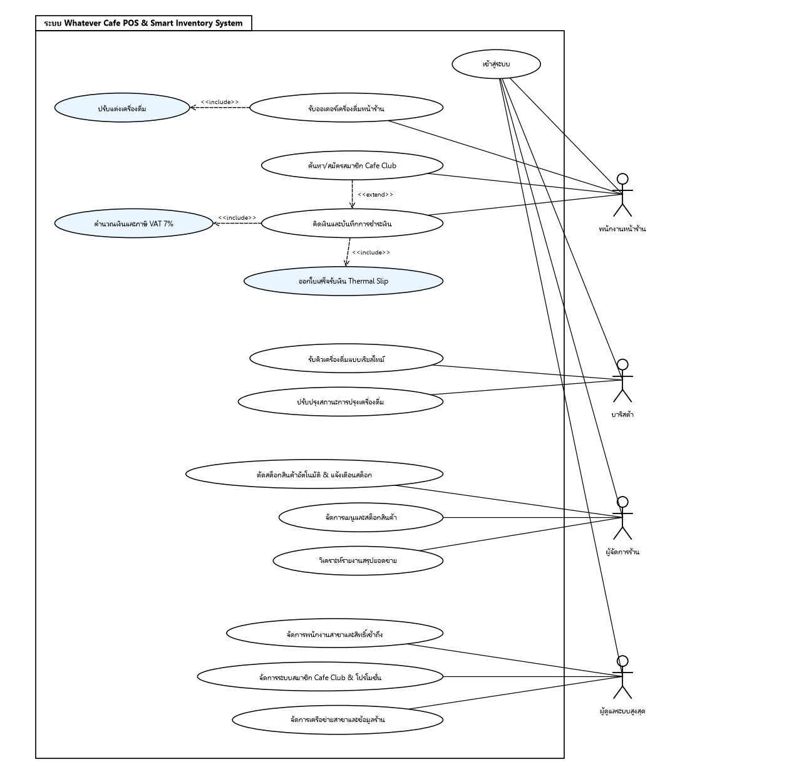

# User Stories + Acceptance Criteria + Use Case Diagram & Descriptions

เอกสารข้อกำหนดเรื่องเล่าผู้ใช้ (User Stories), เกณฑ์การยอมรับ (Acceptance Criteria), แผนภาพยูสเคส (Use Case Diagram), รายละเอียดการทำงานของยูสเคส (Use Case Descriptions) และตารางตรวจสอบความสอดคล้องย้อนกลับไปยังหน้าจอ UI ของระบบ Whatever Cafe POS

---

## 1. User Stories และ Acceptance Criteria (ตามหลัก Given-When-Then)

### 1. การเลือกเมนูและตัวเลือกปรับแต่งเครื่องดื่ม (Cashier POS)
- **US-01:** As a **พนักงานหน้าร้าน (Cashier)** 
  I want ค้นหาเมนู กรองหมวดหมู่ และเปิดหน้าต่างปรับแต่งเครื่องดื่มเพื่อเลือกขนาดแก้ว ระดับความหวาน ท็อปปิ้ง จำนวนแก้ว และระบุหมายเหตุพิเศษ 
  So that ผมสามารถบันทึกรายการคำสั่งซื้อลงในระบบได้อย่างถูกต้อง รวดเร็ว ครบถ้วนตามสูตรที่สั่ง และเพิ่มลงบิลได้อย่างถูกต้อง
- **Acceptance Criteria:**
  - **AC 1.1:** Given พนักงานอยู่บนหน้าจอ `/order.html` When พนักงานพิมพ์ข้อความในช่องค้นหาหรือกดเลือกหมวดหมู่ (ชา, กาแฟ, นม/โกโก้, อื่น ๆ) Then ระบบกรองแสดงเฉพาะการ์ดเมนูที่ตรงกับเงื่อนไข
  - **AC 1.2:** Given พนักงานแตะเลือกการ์ดเมนูที่มีสต็อกคงเหลือ When ระบบเปิดหน้าต่าง *Drink Customization Modal* Then พนักงานสามารถเลือกขนาดแก้ว (S +0฿, M +0฿, L +10฿), ระดับความหวาน (0%, 25%, 50%, 100%), ท็อปปิ้ง (ไข่มุก +10฿, ครีมชีส +15฿, บุกบราวน์ชูการ์ +10฿), ปรับจำนวนแก้วด้วยปุ่ม +/- และพิมพ์หมายเหตุพิเศษได้
  - **AC 1.3:** Given พนักงานปรับแต่งตัวเลือกเสร็จสิ้น When กดปุ่ม "ใส่บิล" Then ระบบคำนวณราคาต่อหน่วยรวมราคาออปชันเพิ่ม และนำรายการเครื่องดื่มพร้อมข้อความรายละเอียดตัวเลือกบันทึกแสดงบนรายการบิลด้านขวา

---

### 2. การคิดเงิน การชำระเงิน และการออกใบเสร็จ (Cashier POS)
- **US-02:** As a **พนักงานหน้าร้าน (Cashier)** 
  I want ให้ระบบคำนวณยอดรวมสินค้า หักส่วนลดสมาชิก Cafe Club 5% คำนวณภาษี VAT 7% สรุปยอดสุทธิ และรองรับการชำระเงินสด (พร้อมปุ่มรับเงินด่วนและคำนวณเงินทอน) หรือสแกน QR PromptPay พร้อมออกใบเสร็จ Thermal Slip 
  So that ผมสามารถปิดการขายได้อย่างแม่นยำ ไม่ผิดพลาด ทอนเงินถูกต้อง และพิมพ์ใบเสร็จรับเงินออกจากระบบได้อย่างสะดวกรวดเร็ว
- **Acceptance Criteria:**
  - **AC 2.1:** Given มีรายการสินค้าอยู่ในตะกร้าบิล When มีการเพิ่ม/ลดจำนวนหรือค้นหาสมาชิกสำเร็จ Then ระบบคำนวณยอดรวม (Subtotal), ส่วนลดสมาชิก 5% (ถ้ามี), ภาษีมูลค่าเพิ่ม VAT 7% และยอดสุทธิ (Net Total) แบบเรียลไทม์
  - **AC 2.2:** Given พนักงานกดปุ่ม "ชำระเงิน" และเลือกชำระด้วยเงินสด (Cash) When ระบุจำนวนเงินที่รับมาหรือกดปุ่มลัด (พอดี, 100, 500, 1000 บาท) Then ระบบคำนวณเงินทอนให้อัตโนมัติ และอนุญาตให้กดยืนยันได้เฉพาะเมื่อเงินที่รับมากกว่าหรือเท่ากับยอดสุทธิเท่านั้น
  - **AC 2.3:** Given พนักงานเลือกชำระด้วย QR Code PromptPay When หน้าต่าง QR Modal แสดงผล Then ระบบแสดงภาพ QR Code พร้อมเพย์และยอดเงินที่ต้องชำระ และมีปุ่มให้กดยืนยันการรับเงิน
  - **AC 2.4:** Given การชำระเงินเสร็จสิ้นสมบูรณ์ When ระบบบันทึกออเดอร์ลงฐานข้อมูล Then ระบบเปิดหน้าต่างใบเสร็จรับเงิน Thermal Slip แสดงข้อมูลครบถ้วน (เลขที่บิล, วันที่เวลา, สาขา, พนักงาน, รายการสินค้าและสูตรชง, ยอดเงิน) พร้อมปุ่มพิมพ์และปุ่มเริ่มบิลใหม่

---

### 3. การรับออเดอร์ในบาร์เครื่องดื่มแบบเรียลไทม์ (Barista KDS)
- **US-03:** As a **บาริสต้า (Barista)** 
  I want ระบบส่งรายละเอียดออเดอร์ที่ชำระเงินสำเร็จมาปรากฏบนหน้าจอคิวบาริสต้า (`/barista.html`) แบบเรียลไทม์ (< 2 วินาที) พร้อมเสียงแจ้งเตือน Chime Alert และตัวจับเวลารอคอย 
  So that ผมสามารถเริ่มปรุงเครื่องดื่มได้ทันทีโดยไม่ต้องรอกระดาษบิล และทราบลำดับคิวได้อย่างถูกต้อง
- **Acceptance Criteria:**
  - **AC 3.1:** Given แคชเชียร์สาขาเดียวกันบันทึกการชำระเงินสำเร็จ When ระบบ Auto-Sync ทำงาน (< 2 วินาที) Then ออเดอร์ใหม่จะปรากฏบนการ์ดคิวของบาริสต้าทันทีโดยไม่ต้องกดรีเฟรชหน้าจอเอง
  - **AC 3.2:** Given มีออเดอร์ใหม่เข้ามาในคิว When ตัวเลือกเสียงเตือนเปิดอยู่ Then ระบบเล่นเสียงสัญญาณ Chime Alert เพื่อเตือนบาริสต้าทันที
  - **AC 3.3:** Given การ์ดออเดอร์แสดงบนหน้าจอ When บาริสต้าตรวจสอบการ์ด Then การ์ดจะแสดงหมายเลขบิล, ชื่อผู้สั่ง/ประเภทบิล, รายการเครื่องดื่มพร้อมขนาดแก้ว ความหวาน ท็อปปิ้ง และตัวจับเวลาแสดงระยะเวลารอคอยนับตั้งแต่เปิดบิล

---

### 4. การจัดการและอัปเดตสถานะคิวเครื่องดื่ม (Barista KDS)
- **US-04:** As a **บาริสต้า (Barista)** 
  I want ปรับเปลี่ยนสถานะคิวเครื่องดื่มตามขั้นตอนการทำงานจริง (รอคิวชง ➔ กำลังปรุง ➔ พร้อมเสิร์ฟ ➔ เสร็จสิ้น) และกรองดูเฉพาะคิวที่สนใจได้ 
  So that ผมสามารถบริหารจัดการคิวในบาร์ได้อย่างมีประสิทธิภาพและส่งมอบเครื่องดื่มตามลำดับคิวได้อย่างราบรื่น
- **Acceptance Criteria:**
  - **AC 4.1:** Given ออเดอร์อยู่ในสถานะ "รอคิวชง (pending)" When บาริสต้ากดปุ่ม "เริ่มปรุง" Then ระบบอัปเดตสถานะเป็น "กำลังปรุง (preparing)" สีของการ์ดจะเปลี่ยน และตัวเลข KPI บนแดชบอร์ดบาริสต้าจะอัปเดตทันที
  - **AC 4.2:** Given ออเดอร์ปรุงเสร็จแล้ว When บาริสต้ากดปุ่ม "พร้อมเสิร์ฟ" Then สถานะเปลี่ยนเป็น "พร้อมเสิร์ฟ (ready)" เพื่อส่งสัญญาณให้เตรียมส่งมอบเครื่องดื่ม
  - **AC 4.3:** Given เครื่องดื่มถูกส่งมอบแก่ผู้รับเรียบร้อยแล้ว When บาริสต้ากดปุ่ม "เสร็จสิ้น" Then สถานะเปลี่ยนเป็น "เสร็จสิ้น (completed)" และออเดอร์จะถูกเก็บออกจากคิวที่ต้องทำ
  - **AC 4.4:** Given บาริสต้าต้องการดูเฉพาะคิวที่คั่งค้าง When กดเลือกแท็บตัวกรอง (Active, Pending, Preparing, Ready, Completed, All) Then หน้าจอแสดงเฉพาะการ์ดที่ตรงกับแท็บที่เลือก

---

### 5. การตัดสต็อกสินค้าอัตโนมัติและการแจ้งเตือนสต็อก (Inventory & Stock Alerts)
- **US-05:** As a **เจ้าของร้านและผู้จัดการร้าน (Store Manager)** 
  I want ระบบหักสต็อกสินค้าของสาขาอัตโนมัติเมื่อมีการสั่งซื้อ บล็อกการขายเมื่อสต็อกหมด และแจ้งเตือนสต็อกใกล้หมด (Threshold < 10 หน่วย) 
  So that ยอดสต็อกในระบบมีความแม่นยำแบบเรียลไทม์ และร้านสามารถวางแผนเติมสต็อกได้ทันท่วงที
- **Acceptance Criteria:**
  - **AC 5.1:** Given แคชเชียร์ยืนยันการขายสำเร็จ When ระบบประมวลผลคำสั่งซื้อ Then ระบบหักจำนวนสินค้าออกจากตาราง `menu_item` ของสาขานั้น (`branch_id`) และบันทึกประวัติลง `stock_movement`
  - **AC 5.2:** Given สินค้าในสาขามีจำนวนคงเหลือ 0 หน่วย (Out of Stock) When พนักงานเปิดหน้าจอสั่งซื้อ Then การ์ดสินค้านั้นจะแสดงป้ายสีเทา "สินค้าหมด" และระบบไม่อนุญาตให้กดสั่งซื้อ
  - **AC 5.3:** Given สต็อกสินค้าคงเหลือหลังหักมีจำนวนต่ำกว่า 10 หน่วย When ระบบประมวลผลออเดอร์ Then ระบบแสดงป้ายเตือน "สต็อกใกล้หมด (<10)" ทั้งบนหน้าจอ POS และการ์ด KPI ในหน้าจัดการเมนู

---

### 6. การค้นหาสมาชิก Cafe Club และสมัครสมาชิกใหม่ (Member Loyalty)
- **US-06:** As a **พนักงานหน้าร้าน (Cashier)** 
  I want ค้นหาข้อมูลสมาชิกด้วยหมายเลขโทรศัพท์ 10 หลักเพื่อมอบส่วนลด 5% สะสมแต้ม และสมัครสมาชิกใหม่ได้ทันทีที่เคาน์เตอร์ 
  So that พนักงานสามารถมอบสิทธิประโยชน์ส่วนลดและสะสมแต้มให้แก่สมาชิกได้อย่างถูกต้อง รวดเร็ว และเพิ่มฐานสมาชิกใหม่ของร้านได้อย่างต่อเนื่อง
- **Acceptance Criteria:**
  - **AC 6.1:** Given แคชเชียร์กรอกเบอร์โทรศัพท์ 10 หลักในกล่องสมาชิก When กดปุ่ม "ตรวจสอบ" แล้วพบข้อมูล Then ระบบแสดงชื่อสมาชิก แต้มสะสม ป้ายยืนยันสิทธิ์สีเขียว และคำนวณส่วนลด 5% หักออกจากยอดบิลทันที
  - **AC 6.2:** Given มีการสมัครสมาชิกรายใหม่ When แคชเชียร์กดปุ่ม "สมัครสมาชิก Cafe Club" แล้วกรอกเบอร์โทร 10 หลักและชื่อสมาชิก แล้วกดยืนยัน Then ระบบสร้างบัญชีสมาชิกลงฐานข้อมูลและนำสิทธิ์ส่วนลด 5% มาใช้กับบิลปัจจุบันได้ทันที
  - **AC 6.3:** Given ออเดอร์ที่มีสิทธิ์สมาชิกชำระเงินเสร็จสิ้น When ระบบบันทึกข้อมูล Then ระบบคำนวณแต้มสะสมเพิ่มให้อัตโนมัติ (1 แต้มต่อทุก 50 บาทหลังหักส่วนลด) และแสดงแต้มบนใบเสร็จรับเงิน

---

### 7. การดูรายงานสรุปยอดขายและการวิเคราะห์ข้อมูล (Manager Sales Analytics)
- **US-07:** As a **ผู้จัดการร้าน (Store Manager)** 
  I want ดูแดชบอร์ดวิเคราะห์ยอดขายรวม จำนวนบิล ยอดเฉลี่ยต่อบิล สัดส่วนรายได้แยกสาขา และ 10 อันดับเมนูขายดี พร้อมตัวกรองช่วงเวลาและสั่งพิมพ์รายงานได้ 
  So that ผมสามารถติดตามผลประกอบการ วิเคราะห์พฤติกรรมการซื้อ และวางแผนกลยุทธ์การขายได้อย่างมีประสิทธิภาพ
- **Acceptance Criteria:**
  - **AC 7.1:** Given ผู้จัดการร้านเปิดหน้า `/report.html` When เลือกตัวกรองช่วงเวลาด่วน (วันนี้, 7 วันล่าสุด, เดือนนี้) หรือระบุวันที่เริ่มต้น-สิ้นสุด Then การ์ด KPIs แสดงยอดขายรวมสุทธิ, จำนวนบิลทั้งหมด และยอดขายเฉลี่ยต่อบิลที่ถูกต้อง
  - **AC 7.2:** Given ผู้จัดการร้านเลือกสาขา (ทุกสาขา หรือเฉพาะสาขาใดสาขาหนึ่ง) When ระบบประมวลผลรายงาน Then ตารางสัดส่วนรายได้แยกสาขาจะแสดงชื่อสาขา จำนวนบิล ยอดขายรวม และคิดเป็นสัดส่วนเปอร์เซ็นต์อย่างถูกต้อง
  - **AC 7.3:** Given หน้าจอรายงานแสดงผล When เลื่อนดูส่วนล่าง Then ระบบแสดงตาราง 10 อันดับเมนูเครื่องดื่มขายดีที่สุด เรียงตามยอดขายรวมและจำนวนแก้วที่ขายได้
  - **AC 7.4:** Given ผู้จัดการร้านต้องการเอกสารรายงานสรุป When กดปุ่ม "พิมพ์สรุปรายงาน" Then ระบบเปิดหน้าต่างสั่งพิมพ์เบราว์เซอร์พร้อมจัดเลย์เอาต์เฉพาะสำหรับการพิมพ์ (@media print) โดยซ่อนเมนูที่ไม่จำเป็น

---

### 8. การยืนยันตัวตนและการควบคุมสิทธิ์ตามบทบาท (Multi-Branch RBAC)
- **US-08:** As a **ผู้ใช้งานระบบทุกบทบาท (User of Whatever Cafe POS)** 
  I want เข้าสู่ระบบด้วย Email/Password หรือใช้ปุ่มสลับบัญชีทดสอบในคลิกเดียว และได้รับการจำกัดสิทธิ์เข้าถึงหน้าจอตามหน้าที่และความรับผิดชอบของตนเอง 
  So that ข้อมูลของระบบมีความปลอดภัย และพนักงานแต่ละฝ่ายทำงานได้อย่างเป็นสัดส่วนโดยไม่ก้าวก่ายสิทธิ์กัน
- **Acceptance Criteria:**
  - **AC 8.1:** Given ผู้ใช้อยู่บนหน้าจอ `/login.html` When ป้อน Email และ Password ถูกต้อง หรือกดปุ่มบัญชีทดสอบด่วน (Cashier, Barista, Manager, Admin HQ) Then ระบบยืนยันตัวตนและนำทางผู้ใช้ไปยังหน้าหลักตามบทบาทตนเองโดยอัตโนมัติ
  - **AC 8.2:** Given พนักงานบทบาท Cashier หรือ Barista เข้าสู่ระบบ Then ระบบจะล็อกสาขาประจำการของพนักงาน (`branch_id`) โดยไม่มีแถบ Navbar ให้กดสลับสาขาหรือเข้าถึงหน้าอื่นๆ
  - **AC 8.3:** Given ผู้ใช้พยายามเข้าสู่หน้าที่ตนเองไม่มีสิทธิ์ (เช่น Cashier พยายามเข้า `/report.html` หรือ Admin HQ พยายามเข้า `/report.html`) Then ระบบ Page Guard จะแสดงหน้าต่างแจ้งเตือนและนำทางกลับไปยังหน้าหลักของบทบาทตนเองทันที

---

### 9. การจัดการเมนูเครื่องดื่มและสต็อกสินค้า (Manager Menu & Stock Management)
- **US-09:** As a **ผู้จัดการร้าน (Store Manager)** 
  I want เพิ่ม แก้ไข และลบรายการเมนูเครื่องดื่ม จัดหมวดหมู่ ตั้งราคา และปรับปรุงจำนวนสต็อกคงเหลือแยกตามสาขา พร้อมดูการ์ดสรุปภาพรวมสินค้า 
  So that รายการเมนูและสต็อกสินค้าของสาขามีความถูกต้อง สดใหม่ และสอดคล้องกับสินค้าที่มีอยู่จริง
- **Acceptance Criteria:**
  - **AC 9.1:** Given ผู้จัดการร้านเปิดหน้า `/menu.html` When ดูการ์ดด้านบน Then ระบบสรุปตัวเลข KPIs 4 ใบ (เมนูทั้งหมดในสาขา, สินค้าพร้อมจำหน่าย, สินค้าสต็อกใกล้หมด < 10, และสินค้าหมดสต็อก)
  - **AC 9.2:** Given ผู้จัดการร้านต้องการเพิ่มเมนู When กดปุ่ม "+ เพิ่มเมนูใหม่" แล้วกรอกชื่อ หมวดหมู่ (ชา, กาแฟ, นม/โกโก้, อื่น ๆ) ราคา และจำนวนสต็อกเริ่มต้น Then ระบบบันทึกเมนูใหม่ลงในสาขาที่เลือกสำเร็จ
  - **AC 9.3:** Given มีเมนูอยู่ในตาราง When ผู้จัดการร้านกดปุ่ม "แก้ไข" แล้วปรับเปลี่ยนราคาหรือปรับปรุงสต็อกคงเหลือ แล้วกดยืนยัน Then ระบบอัปเดตข้อมูลลงฐานข้อมูลและสะท้อนไปยังหน้าจอรับออเดอร์ของแคชเชียร์ทันที
  - **AC 9.4:** Given มีรายการเมนูที่ต้องการยกเลิก When ผู้จัดการร้านกดยืนยันการลบ Then ระบบลบรายการเมนูนั้นออกจากสาขา

---

### 10. ศูนย์ควบคุมระบบส่วนกลางสำนักงานใหญ่ (Admin HQ Central Management)
- **US-10:** As a **ผู้ดูแลระบบสูงสุดสำนักงานใหญ่ (Super Admin HQ)** 
  I want จัดการบัญชีและสิทธิ์พนักงานสาขา (Cashier & Barista), บริหารฐานข้อมูลสมาชิก Cafe Club และปรับระดับโปรโมชั่น, ตลอดจนจัดการเครือข่ายสาขาของร้าน 
  So that ระบบร้านกาแฟทุกสาขาสามารถดำเนินงานได้อย่างมีระเบียบและควบคุมได้จากศูนย์กลาง
- **Acceptance Criteria:**
  - **AC 10.1:** Given ผู้ดูแลระบบเปิดหน้า `/admin.html` ในแท็บ "จัดการพนักงาน" When เพิ่มหรือแก้ไขพนักงาน Then สามารถกำหนดชื่อ อีเมล รหัสผ่าน สาขาที่สังกัด และสิทธิ์ (Cashier หรือ Barista) โดยระบบสงวนสิทธิ์ไม่แสดงและไม่อนุญาตให้แก้ไขบัญชี Manager
  - **AC 10.2:** Given ผู้ดูแลระบบอยู่ในแท็บ "สมาชิก & โปรโมชั่น" When ตรวจสอบหรือแก้ไขข้อมูลสมาชิก Then สามารถค้นหา ปรับปรุงแต้มสะสม และปรับระดับอัตราส่วนลดโปรโมชั่น (5%, 10%, 15%) ได้อย่างอิสระ
  - **AC 10.3:** Given ผู้ดูแลระบบอยู่ในแท็บ "จัดการสาขา" When ตรวจสอบการ์ดเครือข่ายสาขา Then ระบบแสดงชื่อสาขา ที่อยู่ จำนวนพนักงาน และจำนวนเมนูประจำสาขา พร้อมฟอร์มเพิ่มสาขาใหม่และแก้ไขข้อมูลสาขา

---

## 2. Actor ที่เกี่ยวข้องกับระบบร้านกาแฟตามที่กลุ่มวิเคราะห์

| บทบาท (Actor) | หน้าจอหลักในระบบ | สิทธิ์การเข้าถึงและหน้าที่ความรับผิดชอบ | ข้อจำกัดสิทธิ์ |
| :--- | :--- | :--- | :--- |
| **พนักงานหน้าร้าน (Cashier)** | `/order.html` | - รับออเดอร์และปรับแต่งเครื่องดื่ม - ค้นหา/สมัครสมาชิก Cafe Club - คิดเงิน (เงินสด/QR PromptPay) - พิมพ์ใบเสร็จรับเงิน Thermal Slip | ล็อกเฉพาะสาขาของตนเอง ไม่มี Navbar สลับสาขา ไม่สามารถเข้าหน้าบาร์ เมนู หรือรายงานได้ |
| **บาริสต้า (Barista)** | `/barista.html` | - รับคิวชงเครื่องดื่มแบบเรียลไทม์ KDS (< 2s) - ดูสูตร ตัวเลือก และตัวจับเวลารอคิว - อัปเดตสถานะคิว 4 ขั้นตอน - กรองคิวตามสถานะ | ล็อกเฉพาะสาขาของตนเอง ไม่สามารถเข้าหน้าคิดเงิน จัดการเมนู หรือรายงานได้ |
| **ผู้จัดการร้าน (Store Manager)** | `/menu.html` `/report.html` | - จัดการเมนูและสต็อกสินค้า (CRUD) - ตรวจสอบ KPIs และสถานะสต็อก - วิเคราะห์รายงานยอดขายทุกสาขา - ดูสัดส่วนรายได้และ 10 เมนูขายดี - สลับดูข้อมูลได้ทุกสาขา | ไม่สามารถจัดการบัญชีผู้ใช้ระบบส่วนกลางหรือสาขาในหน้า Admin HQ ได้ |
| **ผู้ดูแลระบบสูงสุด (Super Admin HQ)** | `/admin.html` | - จัดการบัญชีพนักงานสาขา (Cashier/Barista) - จัดการฐานข้อมูลสมาชิกและส่วนลด - จัดการเครือข่ายสาขาและที่ตั้งร้าน - ควบคุมภาพรวมจากสำนักงานใหญ่ | **ไม่มีสิทธิ์เข้าถึงรายงานยอดขาย (`/report.html`)** เพื่อแยกความเป็นอิสระของฝ่ายจัดการร้าน |

---

## 3. Use Case Diagram

---

## 4. รายละเอียด Use Case ที่สำคัญ (Use Case Descriptions)

### UC-01: รับออเดอร์ ปรับแต่งเครื่องดื่ม และชำระเงินหน้าร้าน (Cashier POS)
- **Use Case ID:** UC-01
- **Actor:** พนักงานหน้าร้าน (Cashier)
- **Description:** แคชเชียร์รับรายการสั่งซื้อ ปรับแต่งสูตรเครื่องดื่ม (ขนาดแก้ว, ความหวาน, ท็อปปิ้ง, หมายเหตุ) ตรวจสอบและใช้สิทธิ์สมาชิก Cafe Club ลด 5% คำนวณเงิน รับชำระเงินสดหรือ QR PromptPay ตัดสต็อก ส่งคิวไปยังบาริสต้า และพิมพ์ใบเสร็จ Thermal Slip
- **Pre-conditions:**
  1. แคชเชียร์เข้าสู่ระบบสำเร็จ และระบบล็อกสาขาประจำการ (`branch_id`)
  2. มีข้อมูลรายการเมนูและสต็อกพร้อมจำหน่ายในสาขา
- **Post-conditions:**
  1. ข้อมูลออเดอร์ถูกบันทึกลงตาราง `orders` และ `order_item`
  2. สต็อกสินค้าของสาขาถูกตัดทอนลงใน `menu_item` และบันทึกลง `stock_movement`
  3. คิวออเดอร์ถูกส่งไปยังหน้าจอ Barista KDS ของสาขาเดียวกันทันที
  4. ใบเสร็จรับเงิน Thermal Slip แสดงผลบนหน้าจอพร้อมสั่งพิมพ์
- **Main Flow (ลำดับเหตุการณ์ปกติ):**
  1. แคชเชียร์แตะเลือกการ์ดเครื่องดื่มบนหน้าจอ `/order.html`
  2. หน้าต่าง *Drink Customization Modal* ปรากฏขึ้น แคชเชียร์เลือกขนาดแก้ว (S/M/L), ความหวาน (0-100%), ท็อปปิ้ง และจำนวน แล้วกดยืนยันลงบิล (`<<include>>` ปรับแต่งเครื่องดื่ม)
  3. ระบบตรวจสอบสต็อกสินค้า หากเพียงพอจะเพิ่มรายการลงบิลและคำนวณยอดเงินรวม (Subtotal)
  4. หากมีการใช้สิทธิ์สมาชิก แคชเชียร์กรอกเบอร์โทร 10 หลักแล้วกดยืนยัน (`<<extend>>` ค้นหาสมาชิก) ระบบหักส่วนลด 5% และคำนวณภาษี VAT 7% พร้อมแสดงยอดสุทธิ
  5. แคชเชียร์กดปุ่ม "ชำระเงิน" และเลือกช่องทาง (เงินสด หรือ QR PromptPay)
  6. ในกรณีเงินสด แคชเชียร์ระบุเงินที่รับหรือกดปุ่มลัด ระบบคำนวณเงินทอน และกดยืนยันการรับเงิน
  7. ระบบบันทึกออเดอร์ ตัดสต็อก ส่งคิวไปยังบาร์ และเปิดหน้าต่างใบเสร็จรับเงิน Thermal Slip
  8. แคชเชียร์กดพิมพ์ใบเสร็จและกด "เริ่มบิลใหม่" เพื่อพร้อมทำรายการบิลถัดไป
- **Alternative / Exception Flows:**
  - *2a. สต็อกสินค้าไม่พอ (Out of Stock):* ระบบแจ้งเตือนสต็อกไม่พอและไม่อนุญาตให้กดเพิ่มลงบิล แคชเชียร์แจ้งผู้สั่งซื้อเพื่อเปลี่ยนเมนู
  - *4a. มีการสมัครสมาชิกรายใหม่:* แคชเชียร์กดปุ่มสมัครสมาชิก กรอกเบอร์โทรและชื่อ ระบบสร้างบัญชีสมาชิกและให้ส่วนลด 5% ในบิลนี้ทันที
  - *6a. เงินที่รับมาน้อยกว่ายอดสุทธิ:* ปุ่มยืนยันชำระเงินจะไม่ทำงานเพื่อป้องกันการบันทึกผิดพลาด

---

### UC-02: รับคิวและเตรียมเครื่องดื่มในบาร์ (Barista KDS)
- **Use Case ID:** UC-02
- **Actor:** บาริสต้า (Barista)
- **Description:** บาริสต้าดูรายการคิวเครื่องดื่มที่ส่งตรงจากหน้าจอคิดเงินแบบเรียลไทม์ รับฟังเสียงเตือน Chime Alert ดูสูตรและตัวจับเวลา แล้วอัปเดตสถานะคิวจนเครื่องดื่มพร้อมส่งมอบ
- **Pre-conditions:** บาริสต้าล็อกอินเข้าสู่หน้าจอ `/barista.html` ของสาขาตนเอง
- **Post-conditions:** สถานะออเดอร์ในตาราง `orders` ถูกอัปเดต (`pending` ➔ `preparing` ➔ `ready` ➔ `completed`)
- **Main Flow:**
  1. เมื่อมีออเดอร์ชำระเงินสำเร็จ ระบบ Auto-Sync (< 2 วินาที) จะแสดงการ์ดใหม่บนหน้าจอบาริสต้า พร้อมเสียงเตือน Chime Alert
  2. บาริสต้าดูรายละเอียดสูตร (ขนาดแก้ว, ระดับความหวาน, ท็อปปิ้ง, หมายเหตุ) และกดปุ่ม "เริ่มปรุง" เพื่อเปลี่ยนสถานะเป็น `preparing`
  3. เมื่อปรุงเสร็จสิ้น บาริสต้ากดปุ่ม "พร้อมเสิร์ฟ" เพื่อเปลี่ยนสถานะเป็น `ready`
  4. เมื่อส่งมอบสินค้าเรียบร้อย บาริสต้ากดปุ่ม "เสร็จสิ้น" เพื่อเปลี่ยนสถานะเป็น `completed` การ์ดจะถูกย้ายออกจากคิวที่ต้องทำ

---

### UC-03: จัดการเมนูและตรวจสอบสต็อกสินค้า (Manager Menu & Stock)
- **Use Case ID:** UC-03
- **Actor:** ผู้จัดการร้าน (Store Manager)
- **Description:** ผู้จัดการร้านตรวจสอบสรุปตัวเลขสต็อก (KPIs), ค้นหาเมนู, กรองตามหมวดหมู่และสถานะสต็อก, เพิ่มเมนูใหม่, แก้ไขราคา/สต็อก และลบเมนู
- **Main Flow:**
  1. ผู้จัดการร้านเข้าสู่หน้า `/menu.html` ตรวจสอบการ์ด KPIs สต็อก 4 ใบ
  2. กดปุ่ม "+ เพิ่มเมนูใหม่" กรอกชื่อ หมวดหมู่ ราคา และจำนวนสต็อกเริ่มต้น แล้วกดยืนยัน
  3. เมื่อต้องการปรับปรุงสต็อก กดปุ่ม "แก้ไข" ปรับตัวเลขสต็อกคงเหลือ แล้วกดยืนยัน ระบบอัปเดตข้อมูลทันที

---

### UC-04: วิเคราะห์รายงานสรุปยอดขาย (Manager Sales Analytics)
- **Use Case ID:** UC-04
- **Actor:** ผู้จัดการร้าน (Store Manager)
- **Description:** ผู้จัดการร้านเลือกช่วงวันที่และสาขาเพื่อดูยอดขายรวม จำนวนบิล ยอดเฉลี่ยต่อบิล สัดส่วนรายได้แยกตามสาขา และ 10 เมนูขายดี พร้อมสั่งพิมพ์สรุปรายงาน
- **Main Flow:**
  1. ผู้จัดการร้านเข้าสู่หน้า `/report.html` เลือกช่วงเวลา (วันนี้, 7 วัน, เดือนนี้ หรือระบุช่วงวัน)
  2. เลือกสาขาที่ต้องการดู หรือเลือก "ทุกสาขา"
  3. ระบบแสดงผลการ์ด KPIs, ตารางสัดส่วนรายได้แยกสาขา และตาราง 10 เมนูขายดีที่สุด
  4. ผู้จัดการร้านกดปุ่ม "พิมพ์สรุปรายงาน" เพื่อออกรายงานฉบับย่อ

---

### UC-05: ศูนย์ควบคุมและบริหารระบบส่วนกลาง (Admin HQ Central Management)
- **Use Case ID:** UC-05
- **Actor:** ผู้ดูแลระบบสูงสุดสำนักงานใหญ่ (Super Admin HQ)
- **Description:** ผู้ดูแลระบบจัดการข้อมูลพนักงานสาขา (Cashier & Barista), บริหารฐานข้อมูลสมาชิก Cafe Club และโปรโมชั่น, และจัดการข้อมูลเครือข่ายสาขาทั่วทั้งระบบ
- **Main Flow:**
  1. ผู้ดูแลระบบเข้าสู่หน้า `/admin.html` ตรวจสอบการ์ดสรุปจำนวนสาขา พนักงาน และสมาชิก
  2. ในแท็บพนักงาน: ค้นหา เพิ่ม แก้ไข หรือลบบัญชีพนักงาน Cashier หรือ Barista พร้อมกำหนดสาขา
  3. ในแท็บสมาชิก: ดูรายชื่อ ปรับแต้มสะสม และปรับระดับส่วนลดโปรโมชั่น (5%, 10%, 15%)
  4. ในแท็บสาขา: ดูข้อมูลการดำเนินงานของแต่ละสาขา และเพิ่มสาขาใหม่เข้าสู่ระบบ

---

## 5. การตรวจสอบตามหลัก INVEST

| User Story | ผลการตรวจสอบ | ข้อสังเกตและการปรับปรุงให้สอดคล้องกับ UI จริง |
| :--- | :---: | :--- |
| **US-01** (เลือกเมนู & ปรับแต่ง) | **ผ่าน** | เป็นอิสระ (Independent), ทดสอบได้ง่าย (Testable) ผ่านการกดปุ่มบน Customization Modal |
| **US-02** (คิดเงิน & ออกใบเสร็จ) | **ผ่าน** | มีคุณค่าทางธุรกิจสูง (Valuable), ชัดเจนทั้งเงินสด, เงินทอน, QR และ Thermal Slip |
| **US-03** (รับคิว KDS เรียลไทม์) | **ผ่าน** | ขนาดพอเหมาะ (Small), วัดผลได้ด้วย Latency < 2 วินาที และเสียงเตือน Chime Alert |
| **US-04** (จัดการสถานะคิว KDS) | **ผ่าน** | ลำดับสถานะชัดเจน 4 ขั้นตอน ทดสอบได้จากปุ่มกดและการเปลี่ยนสีของการ์ด |
| **US-05** (ตัดสต็อก & แจ้งเตือน) | **ผ่าน** | ป้องกันความผิดพลาดทางธุรกิจ (Valuable) และทดสอบเกณฑ์ Low Stock < 10 ได้อย่างแม่นยำ |
| **US-06** (สมาชิก Cafe Club) | **ผ่าน** | มีขอบเขตกระชับ (Small) ค้นหาเบอร์โทร 10 หลัก ลด 5% และสมัครด่วนหน้าร้านได้ทันที |
| **US-07** (รายงานสรุปยอดขาย) | **ผ่าน** | กรองตามวันและสาขา แสดง KPIs, สัดส่วนสาขา และ 10 เมนูขายดีอย่างครบถ้วน |
| **US-08** (ล็อกอิน & ควบคุมสิทธิ์) | **ผ่าน** | มี Quick Role Switcher ช่วยให้ทดสอบ 4 บทบาทได้อย่างสะดวกรวดเร็ว |
| **US-09** (จัดการเมนู & สต็อก) | **ผ่าน** | รวมการจัดการ CRUD เมนูและการ์ด KPIs 4 ใบไว้เป็นอิสระสำหรับบทบาท Manager |
| **US-10** (ศูนย์ควบคุม Admin HQ) | **ผ่าน** | แยกขอบเขตการคุมส่วนกลาง 3 ด้าน (พนักงาน, สมาชิก, สาขา) โดยไม่แตะต้องรายงานยอดขาย |

---

## 6. UI to User Stories Traceability Matrix (ตารางตรวจสอบย้อนกลับจากหน้าจอ UI สู่ User Stories)

> หมายเหตุ: ชื่อปุ่มและองค์ประกอบในตารางนี้ปรับให้ตรงกับหน้าจอรุ่นใหม่ที่ทีมออกแบบใหม่เมื่อ 19 ตุลาคม 2569 (commit `41c29e1`) ส่วน User Story และ Acceptance Criteria ไม่เปลี่ยน

| หน้าจอ UI จริง (`cafe-pos-database`) | องค์ประกอบบนหน้าจอ (UI Elements) | User Story ที่เกี่ยวข้อง | ข้อกำหนด Acceptance Criteria ที่ครอบคลุม |
| :--- | :--- | :---: | :--- |
| **`login.html`** | - ฟอร์มกรอก Email & Password - การ์ดบัญชีทดลอง Quick Demo Role Switcher (4 บทบาท) | **US-08** | AC 8.1, AC 8.2, AC 8.3 |
| **`order.html` (Catalog)** | - ช่องค้นหาเมนู `menuSearch` - เมนูหมวดหมู่ `categoryPills` (ชา, กาแฟ, นม, อื่นๆ) - การ์ดเมนูพร้อมป้ายสถานะสต็อก | **US-01, US-05** | AC 1.1, AC 5.2 |
| **`order.html` (Customizer)** | - ขนาดแก้ว `sizeChips` (S, M, L) - ความหวาน `sweetChips` (0%, 25%, 50%, 100%) - ท็อปปิ้ง Checkbox (ไข่มุก, ครีมชีส, บุก) - ตัวนับจำนวนแก้ว Stepper `customQtyBtn` | **US-01** | AC 1.2, AC 1.3 |
| **`order.html` (Cart & Member)** | - กล่องค้นหาสมาชิก `memberPhone` & `btnSearchMember` - ป้ายสมาชิกลด 5% `memberBadge` - ปุ่มสมัครสมาชิกด่วน `btnOpenRegisterMember` | **US-06** | AC 6.1, AC 6.2, AC 6.3 |
| **`order.html` (Payment)** | - สรุปยอด Subtotal, Discount 5%, VAT 7%, Net Total - ปุ่มรับเงินสดและคำนวณเงินทอน `cashModal` - ปุ่มสแกน QR PromptPay `qrModal` | **US-02, US-05** | AC 2.1, AC 2.2, AC 2.3, AC 5.1 |
| **`order.html` (Receipt)** | - Thermal Slip Modal แสดงรายละเอียดบิลครบถ้วน - ปุ่มพิมพ์ `btnPrintSlip` & เริ่มบิลใหม่ | **US-02** | AC 2.4 |
| **`barista.html` (KDS Queue)** | - ตัวระบุสถานะ Auto-Sync & ปุ่มเปิดเสียงเตือน - การ์ดออเดอร์แสดงสูตรชงและตัวจับเวลา | **US-03** | AC 3.1, AC 3.2, AC 3.3 |
| **`barista.html` (Workflow)** | - การ์ด KPIs (Pending, Preparing, Ready, Completed) - ปุ่มปรับสถานะการทำงาน 4 ขั้นตอน - แท็บตัวกรองคิว `kdsFilterPills` | **US-04** | AC 4.1, AC 4.2, AC 4.3, AC 4.4 |
| **`menu.html` (Dashboard)** | - การ์ดสรุปสต็อก KPIs 4 ด้าน - ตัวกรองหมวดหมู่และตัวกรองสถานะสต็อก | **US-05, US-09** | AC 5.3, AC 9.1 |
| **`menu.html` (Management)** | - ตารางรายการเมนูพร้อมปุ่มแก้ไข/ลบ - Modal เพิ่มและแก้ไขเมนู (ราคา & สต็อก) | **US-09** | AC 9.2, AC 9.3, AC 9.4 |
| **`admin.html` (Staff Tab)** | - ตารางรายชื่อพนักงานสาขา (Cashier & Barista) - Modal เพิ่ม/แก้ไขพนักงานและกำหนดสาขา | **US-10, US-08** | AC 10.1, AC 8.2 |
| **`admin.html` (Member Tab)** | - ตารางรายชื่อสมาชิก Cafe Club และแต้มสะสม - Modal แก้ไขข้อมูลสมาชิกและปรับอัตราส่วนลด | **US-10, US-06** | AC 10.2 |
| **`admin.html` (Branch Tab)** | - การ์ดข้อมูลสาขา จำนวนพนักงาน และจำนวนเมนู - ฟอร์มเพิ่มสาขาใหม่และแก้ไขข้อมูลสาขา | **US-10** | AC 10.3 |
| **`report.html` (Filters & KPIs)**| - ปุ่มเลือกช่วงเวลาด่วน (วันนี้, 7 วัน, เดือนนี้) / ระบุวันที่ - ตัวเลือกสาขา (ทุกสาขา หรือระบุสาขา) - การ์ดสรุป KPIs (ยอดขายรวม, จำนวนบิล, ยอดเฉลี่ยต่อบิล) | **US-07** | AC 7.1, AC 7.2 |
| **`report.html` (Analytics)** | - ตารางแจกแจงรายได้และสัดส่วนตามสาขา - ตาราง 10 อันดับเมนูขายดีที่สุด - ปุ่มสั่งพิมพ์สรุปรายงาน (@media print) | **US-07** | AC 7.3, AC 7.4 |
