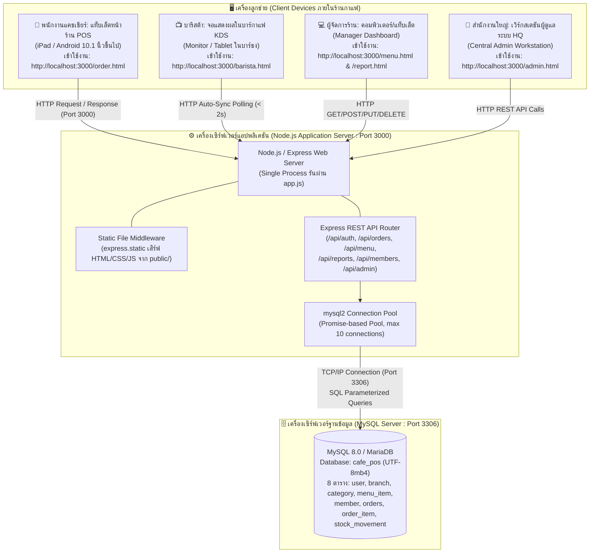
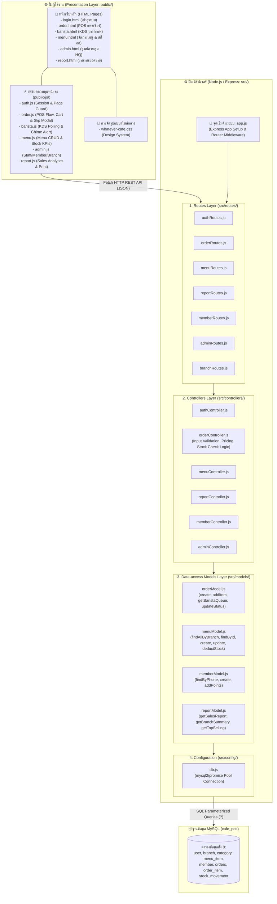

# wk11 — รายงานผลการทำ Workshop: การออกแบบสถาปัตยกรรมระบบและการแบ่ง Component (4+1 Architectural View Model)

**วิชา:** การวิเคราะห์และออกแบบระบบ (Systems Analysis and Design)  
**โครงงาน:** Whatever Cafe POS & Smart Inventory System (กลุ่มที่ 10)  
**ผู้รับผิดชอบโครงงาน:** นายสมพงษ์ เหลืองอ่อน 67160044 *(Project Lead / เจ้าของร้าน)* และทีมงาน (67160010, 67160034, 67160184, 67160198)  

---

## ผลลัพธ์การทำ Workshop ในห้องเรียน (Workshop Deliverables ตามขั้นตอนที่ 7)

1. **ส่วนที่ 1 (Physical View):** Deployment Diagram แสดงโครงสร้างทางกายภาพ เครื่องลูกข่าย เซิร์ฟเวอร์ และเครือข่ายจริง
2. **ส่วนที่ 2 (Development View):** Component Diagram แสดงการจัดระเบียบ Source Code เป็น Layer/Module ตามโครงสร้าง Repository จริง (เวอร์ชัน ก แยก Data-access Model)
3. **ส่วนที่ 3 (สรุปสถาปัตยกรรมของกลุ่ม):** ย่อหน้าสรุปรูปแบบสถาปัตยกรรม Monolithic + Layered Architecture พร้อมการให้เหตุผลที่เจาะจงกับ Repository ของกลุ่มตนเอง

พร้อมทั้งได้รวบรวมมุมมองอีก 3 ด้านที่เหลือ (Scenarios View สัปดาห์ 4, Logical View สัปดาห์ 6, Process View สัปดาห์ 9), การตรวจสอบความสอดคล้องตามเกณฑ์ Rubric CLO7, ตาราง Traceability Matrix และคำตอบคำถามท้ายบททั้ง 6 ข้อ ไว้อย่างครบถ้วนสมบูรณ์

---

## ส่วนที่ 1: Physical View Diagram (Deployment Topology จริงของระบบ)

Physical View แสดงการจัดวาง Node ทางกายภาพ ฮาร์ดแวร์ พอร์ต และการเชื่อมต่อเครือข่ายที่กลุ่มใช้งานจริงตลอดภาคการศึกษา โดยรันเป็น **Single Process Monolith** บน Node.js/Express พอร์ต `3000` และเชื่อมต่อไปยัง MySQL ฐานข้อมูล `cafe_pos` พอร์ต `3306` ภายในเครื่องเดียวกัน (`localhost`) และจำลองหลายสาขาด้วยฟิลด์ `branch_id` โดยไม่มีเครื่องเซิร์ฟเวอร์หรือฐานข้อมูลแยกสาขาตามข้อกำหนดของวิชา:

### คำอธิบายการวิเคราะห์ Physical View:
1. **จำนวน Node ทางกายภาพ:** มีเซิร์ฟเวอร์แอปพลิเคชันและฐานข้อมูลรันอยู่ร่วมกันบนสภาพแวดล้อม Localhost / Docker 1 เครื่อง ไม่มีการสร้าง Node แยกที่ไม่มีอยู่จริง (เช่น ไม่มี Load Balancer หรือ Cloud Instances ภายนอก)
2. **โปรโตคอลการสื่อสาร:**
   - Client เชื่อมต่อไปยัง Server ด้วย **HTTP 1.1** รับส่งข้อมูลในรูปแบบ HTML, CSS, JavaScript และ JSON ผ่านพอร์ต `3000`
   - Application Server เชื่อมต่อไปยัง MySQL Server ด้วย **TCP/IP** ผ่านพอร์ต `3306` ผ่าน `mysql2/promise` connection pool ในไฟล์ `src/config/db.js`
3. **การจำลองสาขา:** ระบบรองรับ Multi-Branch แบบเสมือน โดยบันทึกสาขาลงในฟิลด์ `branch_id` ของฐานข้อมูลเดียวกัน ไม่มีการ Sync ข้อมูลข้ามเครื่องจริง

---

## ส่วนที่ 2: Development View Diagram (การแบ่ง Component และ Module ใน Codebase จริง)

จากการเปิดตรวจสอบโครงสร้าง Repository จริงของกลุ่มเราได้ทำส่วนขยาย **Data-access Model แยกไฟล์** ครบถ้วนแล้วตั้งแต่สัปดาห์ที่ 5-9 จึงเลือกวาดไดอะแกรมตาม **เวอร์ชัน (ก)** ของ `wk11.md` หัวข้อ 3.3 โดยแสดง Layer ที่มีอยู่จริง ได้แก่ Presentation, Routes, Controllers, Data-access Models, Config และ Database:

### การจัดสรรหน้าที่และความรับผิดชอบของโมดูลใน Codebase จริง:
1. **Presentation Layer (`public/`):** จัดการโครงสร้างหน้าจอ UI, ตรวจสอบสิทธิ์ฝั่งไคลเอนต์ (Client-side Role Guard) ผ่าน `localStorage`, การแสดงโมดัลปรับแต่งเครื่องดื่ม, เสียงแจ้งเตือน Chime Alert ในบาร์ และการสั่งพิมพ์ใบเสร็จ `@media print`
2. **Routing Layer (`src/routes/`):** ทำหน้าที่จับคู่ HTTP Method และ Endpoint URL แล้วส่งคำขอต่อไปยัง Controller ที่เกี่ยวข้อง
3. **Controller Layer (`src/controllers/`):** รับคำขอ, ตรวจสอบความถูกต้องของข้อมูล (Validation), คำนวณราคาเครื่องดื่มรวมส่วนลดสมาชิก 5% และภาษี VAT 7%, รวมจำนวนเมนูซ้ำเพื่อตรวจสอบสต็อก และเรียกใช้งาน Data-access Models
4. **Data-access Model Layer (`src/models/`):** จัดการคำสั่ง SQL ทั้งหมดแบบ Parameterized Query ป้องกัน SQL Injection 100% โดยรวบรวมฟังก์ชันการเข้าถึงข้อมูลตาม Entity หลักของระบบ

---

## ส่วนที่ 3: สรุปสถาปัตยกรรมของกลุ่ม (Architecture Summary & Rationale)

> **ย่อหน้าสรุปสถาปัตยกรรมของกลุ่ม (เจาะจงกับ Repository `cafe-pos-group10` ตามขั้นตอนที่ 6):**  
> *"กลุ่มเรา (Whatever Cafe POS — กลุ่มที่ 10 สมาชิก 5 คน รหัสนำโดย 67160044) ใช้สถาปัตยกรรมแบบ **Monolithic ร่วมกับ Layered Architecture** เนื่องจากระบบ deploy เป็น Node.js process เดียวที่รันบน `localhost:3000` โดยรวม routing, business logic, data access และ static web UI ไว้ใน repository เดียวกัน (`cafe-pos-group10`) เชื่อมต่อไปยังฐานข้อมูล MySQL (`cafe_pos`) บนพอร์ต 3306 เครื่องเดียวกัน ทีมมีขนาด 5 คนและมีกรอบระยะเวลาพัฒนา 14 สัปดาห์ การจัดระเบียบโค้ดภายในเป็น Layer อย่างชัดเจนตามที่วางไว้ตั้งแต่สัปดาห์ที่ 5 (แบ่งเป็น `public/` สำหรับ UI, `src/routes/` สำหรับเส้นทาง API, `src/controllers/` สำหรับตรรกะทางธุรกิจ, `src/models/` สำหรับ Data-access Models แยก 4 ไฟล์ และ `src/config/db.js` สำหรับ MySQL Connection Pool) ให้ประโยชน์ด้านการแยกความรับผิดชอบ (Separation of Concerns) ทำให้ทีมสามารถแบ่งงานกันเขียนโค้ดและแก้ไขข้อบกพร่องได้ง่ายโดยไม่กระทบเลเยอร์อื่น โดยยังไม่มีความจำเป็นต้องแยกเป็น Microservices เนื่องจากขอบเขตระบบครอบคลุมการดำเนินงานภายในร้าน 4 ด้านหลัก (POS หน้าร้าน, บาร์ KDS, การจัดการเมนู/สต็อก, และรายงานยอดขาย) และการจำลองหลายสาขาทำผ่านฟิลด์ `branch_id` ในฐานข้อมูลเดียว จึงไม่มีความซับซ้อนของการกระจายฐานข้อมูลข้ามเครือข่าย"*

---

## ส่วนที่ 4: การตรวจสอบความสอดคล้องระหว่าง Diagram กับ Repository จริง 

ตามขั้นตอนที่ 3.4 ในเอกสารวิชา ได้ดำเนินการตรวจสอบความสอดคล้องกับ Repository จริง (`cafe-pos-database` / `cafe-pos-group10`) ผลการประเมินสรุปได้ดังนี้:

| หัวข้อตรวจสอบ | สิ่งที่แสดงใน Diagram | สิ่งที่มีอยู่จริงใน Repository จริง | ผลการตรวจสอบตาม Rubric CLO7 |
| :--- | :--- | :--- | :---: |
| **1. โฟลเดอร์ใน `src/`** | `routes/`, `controllers/`, `models/`, `config/` | มีโฟลเดอร์หลักทั้ง 4 ครบถ้วนใน `src/` | **ผ่าน (ตรงกัน 100%)** |
| **2. Data-access Models** | `orderModel.js`, `menuModel.js`, `memberModel.js`, `reportModel.js` | มีไฟล์ทั้ง 4 ไฟล์อยู่ใน `src/models/` และเรียกคำสั่ง SQL จริง | **ผ่าน (ตรงกัน 100%)** |
| **3. Database Connection** | `src/config/db.js` ใช้ `mysql2/promise` connection pool | มีไฟล์ `src/config/db.js` สร้าง pool ด้วย `mysql.createPool(...)` พอร์ต 3306 | **ผ่าน (ตรงกัน 100%)** |
| **4. Physical Nodes** | 1 เครื่องลูกข่ายเปิดเบราว์เซอร์, 1 Node.js Process (:3000), 1 MySQL (:3306) | รันบน `localhost` พอร์ต 3000 และเชื่อมต่อ MySQL `cafe_pos` พอร์ต 3306 | **ผ่าน (ตรงตามจริง)** |
| **5. ข้อจำกัด Transaction** | ไม่ได้วาดครอบคลุม Transaction ข้ามเครือข่ายเกินจริง | ระบุตรงไปตรงมาว่าการตัดสต็อกเป็น Sequential Query (ดูหัวข้อ 5.1) | **ผ่าน (ตรงตามจริง)** |

### 4.1 การระบุข้อจำกัดของระบบตามความเป็นจริง (Known Architectural Limitations)
1. **ข้อจำกัดเรื่อง Database Transaction Boundary ใน `createOrder`:**  
   ในโค้ดปัจจุบันของ `src/controllers/orderController.js` การสั่งซื้อใช้การรันคำสั่ง SQL แยกทีละคำสั่ง (สร้าง Order ➔ วนลูปสร้าง OrderItem ➔ ตัดสต็อก `deductStock` ทีละรายการ) โดยยังไม่ได้เปิดใช้ `connection.beginTransaction()` และ `commit()` / `rollback()` ครอบทั้งกระบวนการ หากระบบขัดข้องกลางคัน อาจเกิดปัญหาสต็อกถูกตัดไปแล้วแต่บิลไม่สมบูรณ์ ถือเป็นข้อจำกัดทางเทคนิค (Technical Debt) ที่ระบุไว้อย่างตรงไปตรงมาตามที่โจทย์วิชากำหนด
2. **การจำลองหลายสาขาด้วยฟิลด์เดียว:**  
   ระบบจำลองการทำงานหลายสาขาผ่านฟิลด์ `branch_id` ภายในฐานข้อมูลเดียว โดยไม่มีระบบ Data Replication หรือ Distributed Sync ข้ามเซิร์ฟเวอร์จริง

---

